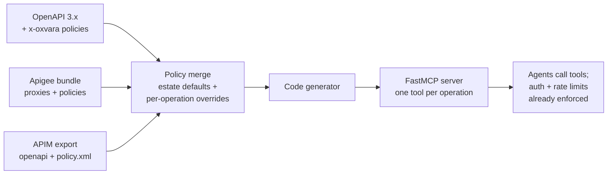

# Oxvara

**One governed front door for every agent, across every gateway you run.**

Apigee and Azure APIM now turn their own APIs into MCP servers. But no
enterprise runs one gateway. You run Apigee here, APIM there, Kong at
the edge, MuleSoft on the legacy estate. No vendor will ever govern
the others.

Oxvara is the vendor-neutral control plane for agentic access. It reads
the API estate you already have, wherever it lives, and compiles
governed MCP servers from it: one onboarding path, one policy model,
one agent identity, one audit log. Auth schemes, rate limits, and
timeouts are inherited from each gateway's own policies instead of
being re-configured for the agent world, and Oxvara adds the pieces no
vendor ships: delegated OAuth2, drift detection, strict policy packs.

## Why not just use your vendor's MCP export?

Fair question, and asked first by everyone technical. Apigee and Azure
APIM both ship native "APIs to MCP" now. If your whole estate lives
behind one of them, use it. Oxvara exists for the estates that don't:

- **Cross-vendor estates.** Most large shops run two to four gateways.
  Apigee's MCP export knows nothing about your APIM APIs, and vice
  versa. Oxvara normalizes all of them into one policy model and one
  tool surface.
- **One agent identity.** A vendor authenticates the agent to its own
  gateway. Oxvara gives the agent one identity across gateways, with
  delegated OAuth2 so agents act with scoped authority instead of
  borrowed keys.
- **One audit log.** Every tool call, every gateway, one JSON-lines
  trail. Auditors don't care which gateway served the call.
- **Drift detection.** When a gateway's policy config moves under you,
  Oxvara flags what changed before your agents find out the hard way.

What Oxvara does not do: replace your gateways, or re-implement what
they already do well. It reads them.

## Quickstart

```bash
pip install "oxvara @ git+https://github.com/kagithamanoj/oxvara.git"

# point it at an OpenAPI file, an Apigee bundle, or an APIM export
oxvara inspect examples/petstore.yaml
oxvara inspect examples/apigee
oxvara inspect examples/apim

# dry run: see the planned tools and inherited policies first
oxvara diff examples/apigee

# check the estate against the strict policy pack
oxvara validate examples/apigee

# compile it into a runnable MCP server
oxvara compile examples/apigee -o petserver.py

# give the generated server its credentials, then run it
export OXVARA_API_KEY=your-key
python petserver.py
```

The generated server speaks MCP over stdio, so point any MCP client at
it (for example Claude Code or any host that accepts an MCP command).

## How it works



1. Oxvara imports your estate from one of three sources (below) and
   normalizes it into one internal model: operations plus the policy
   each one inherits.
2. `oxvara compile` turns every operation into an MCP tool. The
   generated code injects credentials from the environment, substitutes
   path parameters, and enforces rate limits client-side before a
   request ever leaves the process.
3. The tool docstrings carry the inherited policy, so agents see the
   governance in plain language.

## Input sources

**OpenAPI 3.x.** Governance comes from `x-oxvara` blocks. A block at
the document root sets the estate defaults; a block on an operation
overrides them. See `examples/petstore.yaml`.

**Apigee.** Point Oxvara at an exported bundle directory
(`apiproxy/` with `proxies/`, `targets/`, `policies/`). Operations come
from proxy flow conditions (`proxy.pathsuffix MatchesPath ... and
request.verb = ...`). PreFlow policies apply to every operation;
per-flow steps override them. VerifyAPIKey and OAuthV2 map to auth;
Quota and SpikeArrest map to rate limits. A Quota that only carries a
`countRef` (a per-product quota the bundle cannot resolve) contributes
no limit rather than a wrong one. See `examples/apigee/`.

**Azure APIM.** Point Oxvara at an export directory with
`openapi.yaml`, `policy.xml`, and optional
`operations/<operationId>/policy.xml` overrides. Only `<inbound>`
policies are read: `rate-limit` and `quota` (tightest wins),
`check-header` for subscription keys, `authentication-basic`, and
`validate-jwt`. See `examples/apim/`.

## Annotation reference (`x-oxvara`)

| Key | Where | Meaning |
| --- | --- | --- |
| `baseUrl` | root only | Base URL for every generated tool |
| `auth.kind` | root, operation | `apiKey`, `bearer`, `basic`, `oauth2`, `none` |
| `auth.name` | root, operation | Header or query name for `apiKey` |
| `auth.in` | root, operation | `header` or `query` |
| `rateLimit.requests` | root, operation | Request budget |
| `rateLimit.per` | root, operation | `second`, `minute`, or `hour` |
| `timeout` | root, operation | HTTP timeout in seconds (default 30) |

Auth kinds and their credential sources in generated servers:

| Kind | Env var | Sent as |
| ---- | ------- | ------- |
| `apiKey` | `OXVARA_API_KEY` | Header (or query param) named by `auth.name` |
| `bearer` | `OXVARA_BEARER_TOKEN` | `Authorization: Bearer <token>` |
| `basic` | `OXVARA_BASIC_CREDENTIALS` | `Authorization: Basic <base64(user:password)>` |
| `oauth2` | `OXVARA_OAUTH_ACCESS_TOKEN` (delegated token), or `OXVARA_OAUTH_TOKEN_URL` + `_CLIENT_ID` + `_CLIENT_SECRET` [+ `_SCOPE`] | `Authorization: Bearer <token>`; client-credentials tokens are cached until expiry |
| `none` | n/a | No credentials |

## Commands

| Command | What it does |
| ------- | ------------ |
| `oxvara inspect <input>` | List operations and their inherited policies |
| `oxvara diff <input>` | Dry run: planned tools, policies, and governance warnings. Writes nothing |
| `oxvara validate [--pack strict] <input>` | Check the estate against a policy pack; exits non-zero on violations |
| `oxvara compile <input> -o server.py` | Generate the MCP server module |

`<input>` is an OpenAPI file, an Apigee bundle directory, or an APIM
export directory; Oxvara detects which by layout.

## Policy packs

Packs encode the bar an estate must clear before it is exposed to
agents. The `strict` pack requires a base URL, auth on every operation,
a rate limit on every operation, and caps every budget at 1000
requests/minute. Run it in CI to keep new APIs from shipping
ungoverned:

```bash
oxvara validate --pack strict ./my-apim-export
```

## Project status

Working prototype, and labeled as one. The compiler pipeline works end
to end for all three input sources: import, merge policies, generate,
run. What is next: a Kong exporter, policy packs beyond `strict`
(per-team budgets, data-classification rules), a shared rate-budget
store so limits hold across server replicas, and response validation
against the OpenAPI schemas. The roadmap in
[docs/ARCHITECTURE.md](docs/ARCHITECTURE.md) has the details.

What is deliberately not faked: OAuth2 supports delegated token
passthrough and the client-credentials grant only. Authorization-code /
token-exchange (RFC 8693) flows for per-user delegation are not built.
Anything else marked "not implemented" in the docs is exactly that.

## Security model of generated servers

- **Audit log**: every call and response status is written as JSON lines
  to `OXVARA_AUDIT_LOG` (default stderr). Argument values under
  secret-looking keys are redacted; credentials are never logged.
- **Argument injection**: path parameters are percent-encoded, so a value
  like `../admin` cannot add path segments.
- **Untrusted output**: upstream responses are size-capped
  (`OXVARA_MAX_RESPONSE_CHARS`) and labeled as untrusted data. This
  reduces, but does not eliminate, prompt-injection risk from hostile
  API responses.

## Development

```bash
python -m venv .venv && source .venv/bin/activate
pip install -e ".[dev]"
pytest        # full suite
ruff check oxvara tests   # lint, also runs in CI
```

## Contributing

Issues and pull requests are welcome. Keep the no-fake-it rule: if a
feature is not implemented, the code should say so loudly instead of
pretending.

## License

MIT. See [LICENSE](LICENSE).
