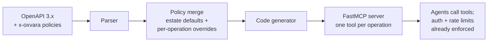

# Oxvara

**Your APIs are agent-ready. Your agents just don't know it.**

Every enterprise already has thousands of REST APIs behind a gateway,
with specs, keys, and rate limits. Agents speak MCP, not REST. Converting
even one critical API into a governed MCP server takes an engineer days.
Doing it for a whole estate takes quarters.

Oxvara reads the API estate you already have and compiles governed
MCP servers from it. Auth schemes, rate limits, and timeouts are
inherited from the estate's own policies instead of being re-configured
for the agent world. It is the onboarding plane for MCP, not another
gateway.

## Quickstart

```bash
pip install "oxvara @ git+https://github.com/kagithamanoj/oxvara.git"

# see what an estate contains and which policies each operation inherits
oxvara inspect examples/petstore.yaml

# compile it into a runnable MCP server
oxvara compile examples/petstore.yaml -o petserver.py

# give the generated server its credentials, then run it
export OXVARA_API_KEY=your-key
python petserver.py
```

The generated server speaks MCP over stdio, so point any MCP client at
it (for example Claude Code or any host that accepts an MCP command).

## How it works



1. You annotate the estate once with `x-oxvara` blocks: base URL,
   auth scheme, rate limits, timeouts. Per-operation blocks override
   the defaults where needed.
2. `oxvara compile` turns every operation into an MCP tool. The
   generated code injects your credentials, substitutes path parameters,
   and enforces rate limits client-side before a request ever leaves
   the process.
3. The tool docstrings carry the inherited policy, so agents see the
   governance in plain language.

See [docs/ARCHITECTURE.md](docs/ARCHITECTURE.md) for the full design,
the policy inheritance model, and the annotation reference.

## Project status

Early prototype, and labeled as one. The compiler pipeline works end to
end: parse, merge policies, generate, run. What is next: Apigee X and
Azure APIM exporters so nobody hand-writes annotations, policy packs,
dry-run diffs, and a shared rate budget store. The roadmap in the
architecture doc has the details.

## Development

```bash
python -m venv .venv && source .venv/bin/activate
pip install -e ".[dev]"
pytest
```

## Contributing

Issues and pull requests are welcome. Keep the no-fake-it rule: if a
feature is not implemented, the code should say so loudly instead of
pretending.

## License

MIT. See [LICENSE](LICENSE).
